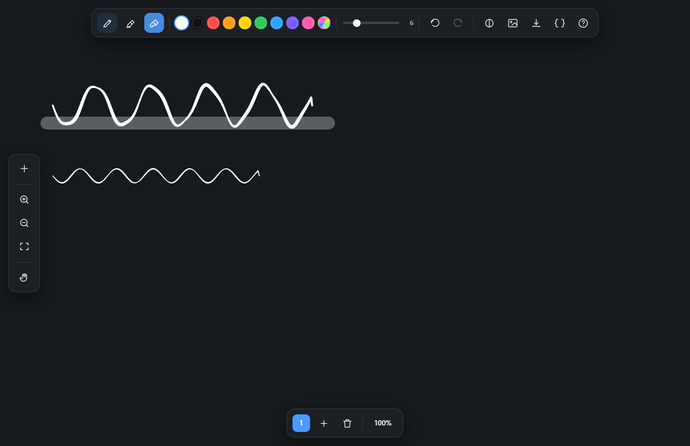

# MWhiteboard

**在微软官方 Windows 外壳里跑的本地离线白板。**

面向消费者的 Microsoft Whiteboard 已于 2026-10 停用。官方客户端打开后只显示
「感谢你使用 Microsoft Whiteboard / 已于 2026 年 10 月停用」，没有画廊、没法画。
这套东西让它在**本机离线**继续可用：窗口、包身份、WebView2、输入栈全是微软原装，
里面跑的页面换成了自己写的 41KB 单文件白板，书写引擎按原版 ink core 逆向移植。



当前状态：**已安装并验证通过**（零管理员方案，见下文 A）。

---

## 一、为什么能绕开（实测出来的真实机制）

外壳 `MicrosoftWhiteboard.exe` 是个 WebView2 套壳（`Windows.FullTrustApplication`）。
启动流程实测如下：

1. 外壳把 webview 导航到
   `https://whiteboard.cloud.microsoft/?windowsReleaseNotification=true&embed=desktop-app&pwaHost={...}&lng=zh&...`
2. 这个 URL 加载成功 → **页面里画什么就是什么**。真 bundle 加载成功时，它在应用内
   渲染退役文案；**不会**跳走。
3. 只有这个 URL **加载失败**（DNS/TLS/连不上）才会走
   `ShowOfflinePageOnErrorAsync` → 跳到 `https://local.whiteboard.microsoft.com/LocalizedOfflinePage.html`。

关键推论（踩过才知道）：

- **换离线页文件没用**。`%LOCALAPPDATA%\Packages\Microsoft.Whiteboard_8wekyb3d8bbwe\LocalState\LocalizedOfflinePage.html`
  每次启动都会被 `SetupLocalizedOfflinePageFile` 重新生成（实测 46651 字节原文件被覆盖回来）。
  而且正常联网时根本走不到这条分支。
- **支点只有一个**：让外壳在 app URL 上加载到我们的页面。

于是方案就是：把这个域名的解析（只在这一个应用的进程内）指向本机 HTTPS 服务，
服务返回我们自己的单文件白板。`server.py` 仍然保留 `/api/*` 的 `enabled=true` 空壳，
防止外壳哪天加回原生判定。

---

## 二、三种用法

### A. 零管理员 · 保留官方外壳（**推荐，已装好**）

```powershell
pwsh -File .\install-noadmin.ps1          # 安装 + 启动
pwsh -File .\install-noadmin.ps1 -Uninstall   # 完全回滚
```

干三件事，全在用户层：

| # | 动作 | 位置 | 影响面 |
|---|---|---|---|
| 1 | 用户级环境变量 `WEBVIEW2_ADDITIONAL_BROWSER_ARGUMENTS` | `HKCU\Environment` | 只加 `--host-resolver-rules` 把 `whiteboard.cloud.microsoft` 映射到 `127.0.0.1:8443`；同时**镜像**你现有的系统代理并只把该域名放进 bypass 列表 |
| 2 | 自签 CA 装进 `CurrentUser\Root` | `HKCU\Software\Microsoft\SystemCertificates\Root` | 只影响当前用户，只信任这一张证书 |
| 3 | 本地 HTTPS 服务 + 登录自启 | `server.py`（8443）+ 计划任务 `wb-local-server` | 只监听 127.0.0.1 |

**没有**改 hosts、没有停 `VMwareHostd`、没有占 443、没有要管理员。

关于「只对白板生效」：环境变量本身是 WebView2 全局的，但带的三条 flag 作用域极窄 ——
`--host-resolver-rules` 只对 `whiteboard.cloud.microsoft` 生效，`--proxy-bypass-list`
里也只有这一个域名，`--proxy-server` 是把你现有的 `127.0.0.1:7890` 原样镜像一遍。
所以其他 WebView2 应用（Teams / Outlook / Copilot…）的流量行为不变，唯一的耦合是：
**你改了代理端口就要重跑一次 `install-noadmin.ps1`**。

想要真正 per-app（连环境变量都不碰），用下面的 A+。

### A+. 可选升级：per-app 策略（要一次 UAC）

```powershell
# 在能点「是」的终端里，或右键 → 以管理员身份运行
pwsh -File .\install-scoped.ps1
pwsh -File .\install-scoped.ps1 -Uninstall
```

写 `HKCU\Software\Policies\Microsoft\Edge\WebView2\AdditionalBrowserArguments`，
值名 `MicrosoftWhiteboard.exe`（WebView2 官方支持 per-app 参数），并清掉 A 用的环境变量。
`HKCU\Software\Policies` 对普通用户只读，所以这一步绕不过 UAC —— 只有它需要。

### B. 完全不碰系统（零风险，日常随手记）

```powershell
pwsh -File .\launch-edge.ps1
```

Edge 的 `--app` 窗口 + 独立 profile，不要证书不要服务。数据和 A 是两套 IndexedDB。

### C. 抢救旧内容

```powershell
python .\salvage.py      # 已跑过：boards\ + gallery.html
```

35 张旧白板缩略图（405×231 PNG，能看清手写内容）。想重画就「导入图片当底图」半透明描一遍。

---

## 三、目录

```
wb-local/
  whiteboard.html        离线白板（单文件，无外部依赖，41KB）
  server.py              本地服务：/health + /api/* 空壳 + 托管白板页（--https-only）
  install-noadmin.ps1    ★ A：环境变量 + 证书 + 服务 + 登录自启
  install-scoped.ps1     A+：per-app WebView2 策略（需 UAC）
  launch-edge.ps1        B：Edge app 窗口
  shot.ps1               抓白板窗口截图（PrintWindow，不依赖 CDP）
  cdp.mjs                极简 CDP 客户端（list / shot / eval / html）
  _re/                   逆向工作区：984 个 webpack chunk、模块提取、探针脚本
    ink-test.mjs         无头 Edge + CDP 的墨迹引擎回归测试
    probe.mjs            单表达式探针（可强制出帧后读像素）
  salvage.py             从 IndexedDB 抢救缩略图
  setup.ps1  teardown.ps1   旧方案（hosts + 443），已废弃，仅留作参考
  backup.ps1             整包备份 + restore.md
  boards/                35 张已抢救的缩略图
  gallery.html           缩略图画廊
  cert.pem / key.pem     自签证书（10 年，SAN 含 whiteboard.cloud.microsoft 等）
  evidence-before.png    卸载状态：微软退役页
  evidence-after.png     安装状态：本地白板（同一个原生窗口）
```

---

## 四、白板功能 / 快捷键

笔（原版墨迹引擎，压感 taper）、荧光笔（半透明混合）、整笔擦除、9 色 + 自定义、笔宽、
撤销/重做（60 步）、多页、平移缩放、深色/纸白/方格/点阵、导入底图、导出 PNG、
JSON 备份/恢复、IndexedDB 自动保存（500ms 防抖）。书写引擎细节见第七节。

`1/2/3` 切工具 · `Ctrl+Z / Ctrl+Y` · `Ctrl+滚轮` 缩放 · `空格+拖动` 平移 ·
`[` `]` 笔宽 · `Ctrl+S` 导出 PNG · `0` 复位 · `?` 帮助

触屏单指拖动=平移、笔照常写（防误触）；鼠标/触控笔直接画。

---

## 五、坑（全部实测过）

1. **系统代理会让 `--host-resolver-rules` 失效**。走代理时域名由代理端解析，
   resolver rules 完全不生效（会拿到真微软页）。所以 flag 里必须同时出现
   `--proxy-server` + `--proxy-bypass-list`，或者 `--no-proxy-server`。
2. **`--ignore-certificate-errors-spki-list` 在本机 Edge/WebView2 不生效**（实测移除根证书后
   dump-dom 为空）。TLS 信任只能靠把证书装进 `CurrentUser\Root`。
3. **`certutil -user -delstore` 和 `Remove-Item Cert:\CurrentUser\Root\...` 都会弹 UI 确认**，
   非交互会话直接报「此操作针对用户根存储，不允许使用 UI」。回滚用删注册表键的方式
   （`HKCU\Software\Microsoft\SystemCertificates\Root\Certificates\<thumb>`），已写进脚本。
4. **`schtasks /Create /TR "wscript.exe \"路径\""` 嵌套引号必炸**。用
   `Register-ScheduledTask` 才行（普通用户可注册自己的登录任务）。
5. **`Start-Process -Verb RunAs` 在非交互会话里直接 `操作已被用户取消`**（ERROR_CANCELLED），
   所以 A+ 必须你自己双击/在终端点「是」。
6. **离线页文件会被重新生成**，别指望换它（见第一节）。
7. **Store 可能把包删掉**。先跑 `backup.ps1`（默认 `D:\wb-backup\<时间>`），
   里面有 `restore.md`（`Add-AppxPackage -Register` 重新注册）。
8. **数据在 WebView2 profile 里**。A 存在
   `%LOCALAPPDATA%\Packages\Microsoft.Whiteboard_8wekyb3d8bbwe\LocalState\EBWebView`，
   B 存在 `%LOCALAPPDATA%\wb-local-edge`。清缓存会丢，重要内容用 JSON 导出。
9. **外壳里的登录/分享/协作是死的**，没有后端，点了没反应，正常。
10. **正文救不回来**。旧白板内容 2026-10 在服务端删了，本地只有缩略图；
    `LocalState\SURFACE-159.50` 那堆 `.ldb` 是 MSAL token 缓存，不是内容。

---

## 六、已验证（本机实测）

- 完整循环：卸载 → 重启应用 → 微软退役页（`evidence-before.png`）；
  安装 → 重启应用 → 本地白板且笔迹持久化（`evidence-after.png`，两次截图字节一致）
- `GET /health` → `{"ok":true}`；`GET /api/v1.0/whiteboards/enabled` → `{"enabled":true,...}`
- 自签证书 + 真实域名 TLS 校验通过（`ssl_verify_result=0`）
- 白板页 CDP 冒烟：画一笔 60 采样点 → IndexedDB 落盘 → 撤销清零 → 缩放 120%，全 PASS
- 卸载后四项全清：环境变量空、计划任务不存在、证书不在 Root、8443 无监听
- 系统 DNS / hosts 未被改动（`whiteboard.cloud.microsoft` 解析结果与安装前一致）

---

## 七、书写引擎：从原版 ink core 逆向移植

原版白板前端是 webpack 打包，入口 `app.v26.11029.105.js` 里带完整 chunk 映射表
（643 个 name / 987 个 hash）。落盘了 984 个 chunk，书写相关的在
`BoardEditorComponent-84781932.*.js`（165KB）与 `InkBeautifier.*.js`（74KB）里。
协作/认证/Fluid 容器协议**没有**碰，只取了「一根笔从采样到上屏」这条链。

### 管线（原版结构 → 本地实现）

| 阶段 | 原版 | 本地 |
|---|---|---|
| 采样 | `addPoint` + 合并事件展开 | `inkFeedPen` / `inkFeedMouse` |
| 抽稀/拟合 | `new g.j(8e-4/w)` 垂距过滤；鼠标走均匀三次 B 样条 + `new p.k(0.1,0.2,false)` 细分 | `perpDist2` + `SPLINE_B` + `flattenRec` |
| 压力→笔宽 | `(0,c.u)(e,r.Jd,r.tV)` 归一化，笔宽倍率 `P(p)=1.5p+0.25` | `inkMul(p)` |
| 上屏 | 每点画圆 + 相邻圆外公切线四边形，nonzero 并集 | `inkDot` / `inkSeg` + `fill(path,'nonzero')` |

关键常量（全部照抄原版，未调参）：

```js
INK_GAIN = 1.5      // P(p) = 1.5p + 0.25
INK_BASE = 0.25
INK_DECIM = 8e-4    // 抽稀阈值，再除以 zoom
INK_FLAT2 = 0.01    // 细分容差 0.1 的平方
HL_SCALE = 2.2      // 荧光笔倍宽
HL_ALPHA = 0.3
```

### 和原版的三处差异（有意的）

1. **没有墨迹预测（prediction）**。原版 `predictionContext` 会用历史点外推一帧，
   能再低 1 帧延迟，但实现要动渲染时序，收益在 60Hz 屏上不明显，没做。
2. **没有笔迹美化（InkBeautifier）**。原版 `(0,f.KS)(t,s,n)` 用 `s=.05, n=20, i=.95`
   判定「这段像几何图形」然后拉直成直线/圆/矩形。属于「改写你画的东西」，没移植。
3. **橡皮是整笔擦除**，原版支持部分擦除（把一笔切成两笔）。

### 实测数据（`_re/ink-test.mjs`，无头 Edge + CDP）

```
笔压 0.1 → 墨迹 2px     笔压 1.0 → 6px     （width=3）
width=12 时 [0.1,0.3,0.55,0.8,1.0] → [6,10,14,18,22]
                        理论值       → [4.8,8.4,12.9,17.4,21]   ← 斜率一致，差值全是抗锯齿
直线抽稀 41 点 → 2 点；正弦 120 点全保留；鼠标 60 点 → B 样条 62 点（末端 gap=0）
nonzero 并集无空洞；撤销/重做 [4,3,4]；IndexedDB 落盘一致
```

性能（这台机器）：

```
输入管线      3000 事件单笔 180ms（0.06ms/事件）
路径构建      2976 点 1.82ms      ← 去掉 closePath 前是 112ms
路径填充      0.05ms/帧
```

> 坑：`Path2D.closePath()` 在 Chromium 单次约 30µs，几千个四边形就能把一次路径构建
> 从 2ms 拖到 100ms+。`fill()` 本来就会自动闭合子路径，别调它。

### 回归测试

```powershell
cd wb-local
node _re\ink-test.mjs                       # 画→强制出帧→量像素/撤销/落盘，打印 DRAW/MEAS
node _re\probe.mjs _re\expr4.js out.png     # 任意探针，第二参数给 .png 就是出图
```

无头模式下 rAF 会被节流，**必须**靠 `Page.captureScreenshot` 强制出一帧再读像素，
否则会读到上一帧，表现为「后面的笔画没画上」。

---

## 八、没做的部分（有意留白）

原版前端共 643 个具名 chunk，本仓库只碰了「一根笔从采样到上屏」这条链。
其余按依赖关系分两类：

**服务端依赖，即使逆向也跑不起来**：模板的服务器端定义、Copilot、分享、评论、
投票汇总、遥测、账号。代码只是前端外壳，逻辑在服务端。

**纯前端、可以做但没做**：

| 层 | 缺的东西 |
|---|---|
| 书写 | 墨迹预测、`InkBeautifier` 形状拉直、部分擦除（`splitStroke`）、套索选择与组变换、`tiltX/tiltY` 倾斜量、笔迹回放 |
| 对象 | 形状与连接线、文本框/富文本、表格、可拖动图片、便签、对象右键菜单 |
| 应用 | 约 90 个模板、投票、计时器、评论、PDF/ZIP 导出、快照、演示模式、设置 |

其中 `splitStroke`（部分擦除）、套索选择、文本与便签是书写体验缺口最大的三块。


