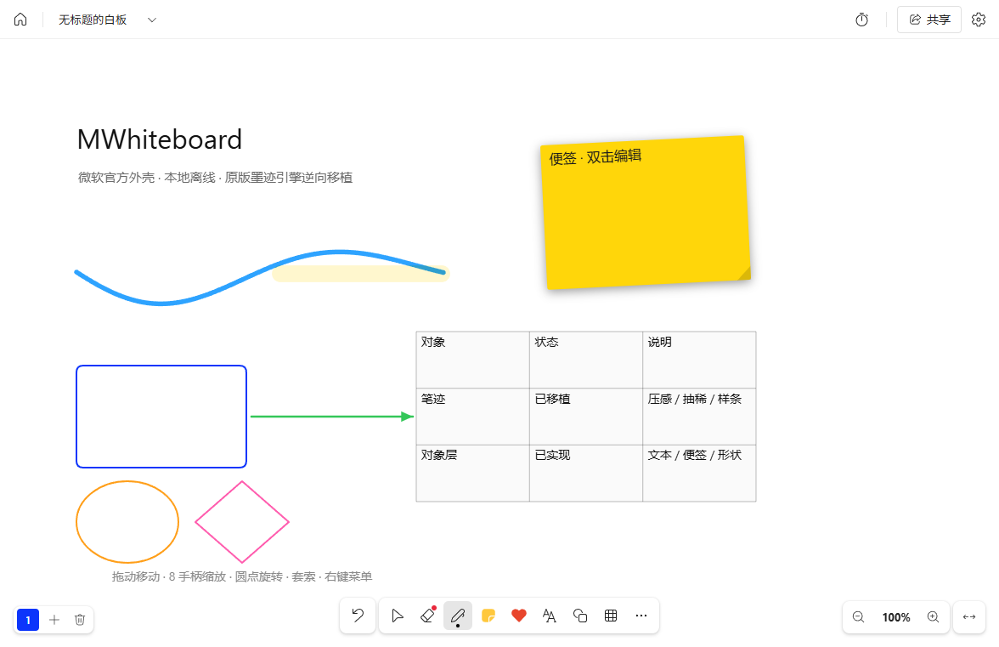
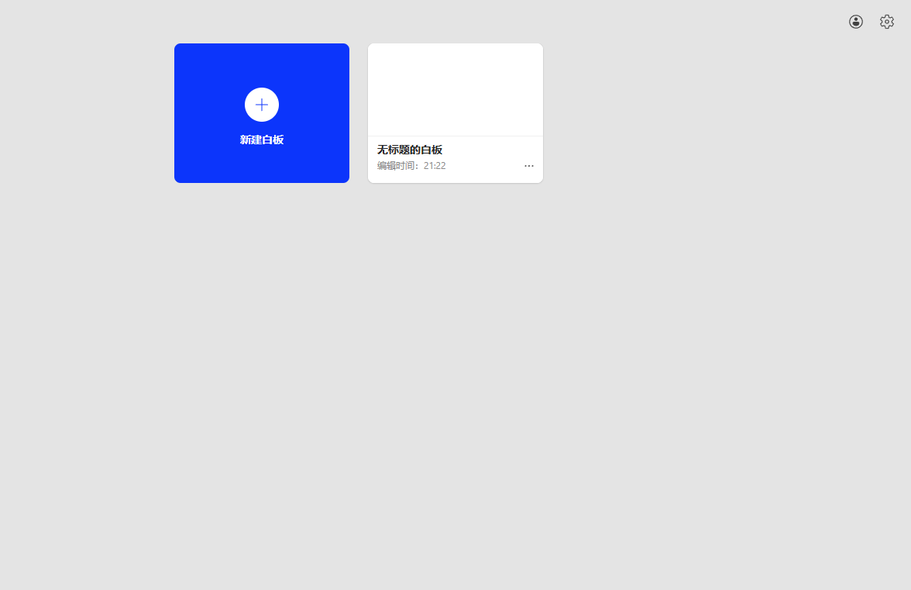
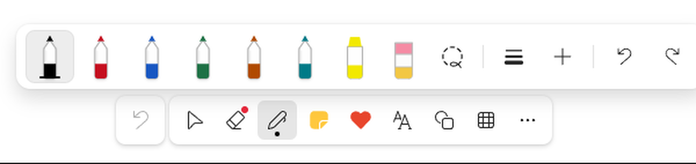

# MWhiteboard

**在微软官方 Windows 外壳里跑的本地离线白板。**

面向消费者的 Microsoft Whiteboard 已于 2026-10 停用。官方客户端打开后只显示
「感谢你使用 Microsoft Whiteboard / 已于 2026 年 10 月停用」，没有画廊、没法画。
这套东西让它在**本机离线**继续可用：窗口、包身份、WebView2、输入栈全是微软原装，
里面跑的页面换成了自己写的单文件白板（约 3260 行 / 154KB），
书写引擎按原版 ink core 逆向移植，对象层（文本/便签/形状/表格/图片）自建，
外观（画廊 + 顶栏 + 工具栏 + 笔盘 + 缩放）对着原版截图逐像素取色复刻。





当前状态：**已安装并验证通过**（零管理员方案，见下文 A）。

---

## 一、为什么能绕开（实测出来的真实机制）

外壳 `MicrosoftWhiteboard.exe` 是个 WebView2 套壳（`Windows.FullTrustApplication`）。
启动流程实测如下：

1. 外壳把 webview 导航到
   `https://whiteboard.cloud.microsoft/?windowsReleaseNotification=true&embed=desktop-app&pwaHost={...}&lng=zh&...`
2. 这个 URL 加载成功 → **页面里画什么就是什么**。真 bundle 加载成功时，它在应用内
   渲染退役文案；**不会**跳走。
3. 只有这个 URL **加载失败**（DNS/TLS/连不上）才会走
   `ShowOfflinePageOnErrorAsync` → 跳到 `https://local.whiteboard.microsoft.com/LocalizedOfflinePage.html`。

关键推论（踩过才知道）：

- **换离线页文件没用**。`%LOCALAPPDATA%\Packages\Microsoft.Whiteboard_8wekyb3d8bbwe\LocalState\LocalizedOfflinePage.html`
  每次启动都会被 `SetupLocalizedOfflinePageFile` 重新生成（实测 46651 字节原文件被覆盖回来）。
  而且正常联网时根本走不到这条分支。
- **支点只有一个**：让外壳在 app URL 上加载到我们的页面。

于是方案就是：把这个域名的解析（只在这一个应用的进程内）指向本机 HTTPS 服务，
服务返回我们自己的单文件白板。`server.py` 仍然保留 `/api/*` 的 `enabled=true` 空壳，
防止外壳哪天加回原生判定。

---

## 二、三种用法

### A. 零管理员 · 保留官方外壳（**推荐，已装好**）

```powershell
pwsh -File .\install-noadmin.ps1          # 安装 + 启动
pwsh -File .\install-noadmin.ps1 -Uninstall   # 完全回滚
```

干三件事，全在用户层：

| # | 动作 | 位置 | 影响面 |
|---|---|---|---|
| 1 | 用户级环境变量 `WEBVIEW2_ADDITIONAL_BROWSER_ARGUMENTS` | `HKCU\Environment` | 只加 `--host-resolver-rules` 把 `whiteboard.cloud.microsoft` 映射到 `127.0.0.1:8443`；同时**镜像**你现有的系统代理并只把该域名放进 bypass 列表 |
| 2 | 自签 CA 装进 `CurrentUser\Root` | `HKCU\Software\Microsoft\SystemCertificates\Root` | 只影响当前用户，只信任这一张证书 |
| 3 | 本地 HTTPS 服务 + 登录自启 | `server.py`（8443）+ 计划任务 `wb-local-server` | 只监听 127.0.0.1 |

**没有**改 hosts、没有停 `VMwareHostd`、没有占 443、没有要管理员。

关于「只对白板生效」：环境变量本身是 WebView2 全局的，但带的三条 flag 作用域极窄 ——
`--host-resolver-rules` 只对 `whiteboard.cloud.microsoft` 生效，`--proxy-bypass-list`
里也只有这一个域名，`--proxy-server` 是把你现有的 `127.0.0.1:7890` 原样镜像一遍。
所以其他 WebView2 应用（Teams / Outlook / Copilot…）的流量行为不变，唯一的耦合是：
**你改了代理端口就要重跑一次 `install-noadmin.ps1`**。

想要真正 per-app（连环境变量都不碰），用下面的 A+。

### A+. 可选升级：per-app 策略（要一次 UAC）

```powershell
# 在能点「是」的终端里，或右键 → 以管理员身份运行
pwsh -File .\install-scoped.ps1
pwsh -File .\install-scoped.ps1 -Uninstall
```

写 `HKCU\Software\Policies\Microsoft\Edge\WebView2\AdditionalBrowserArguments`，
值名 `MicrosoftWhiteboard.exe`（WebView2 官方支持 per-app 参数），并清掉 A 用的环境变量。
`HKCU\Software\Policies` 对普通用户只读，所以这一步绕不过 UAC —— 只有它需要。

### B. 完全不碰系统（零风险，日常随手记）

```powershell
pwsh -File .\launch-edge.ps1
```

Edge 的 `--app` 窗口 + 独立 profile，不要证书不要服务。数据和 A 是两套 IndexedDB。

### C. 抢救旧内容

```powershell
python .\salvage.py      # 已跑过：boards\ + gallery.html
```

35 张旧白板缩略图（405×231 PNG，能看清手写内容）。想重画就「导入图片当底图」半透明描一遍。

---

## 三、目录

```
wb-local/
  whiteboard.html        离线白板（单文件，无外部依赖，约 3260 行 / 154KB）
tray.png               笔盘截图（README 用）
  server.py              本地服务：/health + /api/* 空壳 + 托管白板页（--https-only）
  install-noadmin.ps1    ★ A：环境变量 + 证书 + 服务 + 登录自启
  install-scoped.ps1     A+：per-app WebView2 策略（需 UAC）
  launch-edge.ps1        B：Edge app 窗口
  shot.ps1               抓白板窗口截图（PrintWindow，不依赖 CDP）
  cdp.mjs                极简 CDP 客户端（list / shot / eval / html）
  _re/                   逆向工作区：984 个 webpack chunk、模块提取、探针脚本
    ink-test.mjs         无头 Edge + CDP 的墨迹引擎回归测试
    obj-test.js          对象层 21 项回归（node _re\probe.mjs _re\obj-test.js）
    demo.js              生成下面那张演示板
    icons.js             46 个 Fluent 图标的内联 path（生成物，已内联进 html）
    mkicons.js           icons/*.svg → icons.js
    splice.py            CSS/DOM/chrome.js 拼进 whiteboard.html 的一次性脚本
    probe.mjs            单表达式探针（可强制出帧后读像素）
  demo.png               演示板（README 头图）
  gallery.png            画廊页
  salvage.py             从 IndexedDB 抢救缩略图
  setup.ps1  teardown.ps1   旧方案（hosts + 443），已废弃，仅留作参考
  backup.ps1             整包备份 + restore.md
  boards/                35 张已抢救的缩略图
  gallery.html           缩略图画廊
  cert.pem / key.pem     自签证书（10 年，SAN 含 whiteboard.cloud.microsoft 等）
  evidence-before.png    卸载状态：微软退役页
  evidence-after.png     安装状态：本地白板（同一个原生窗口）
```

---

## 四、白板功能 / 快捷键

**书写**：笔（原版墨迹引擎，压感 taper + 倾斜加宽）、荧光笔 3 档（半透明混合）、
整笔擦除、局部擦除（把一笔切成多笔）、9 色 + 自定义、笔宽、撤销/重做（60 步）、
多页、平移缩放、深色/纸白/方格/点阵、笔迹回放、导出 PNG、JSON 备份/恢复、
IndexedDB 自动保存（500ms 防抖）。

**对象**：文本、便签（5 色）、形状（矩形/椭圆/三角/菱形/直线/箭头，箭头端点自动吸附对象边缘）、
表格（3×3，双击单元格编辑）、图片（可拖动/缩放/旋转）、框选、套索、8 手柄缩放、
旋转（Shift 吸附 15°）、复制、置顶/置底、右键菜单。

对象和笔迹同处一个 `items` 数组，**数组顺序就是 z 序**；文档格式 `doc.version = 2`，
旧的 v1（`page.strokes`）读入时自动迁移。

| 键 | 作用 |
|---|---|
| `1` `2` `3` `4` | 笔 / 荧光笔 / 整笔橡皮 / 局部橡皮 |
| `V` `L` | 选择 / 套索 |
| `T` `N` `S` `B` `I` | 文本 / 便签 / 形状 / 表格 / 图片 |
| `H` / `空格` | 平移 |
| `Ctrl+Z` `Ctrl+Y` | 撤销 / 重做 |
| `Ctrl+A` `Ctrl+D` `Delete` | 全选 / 复制 / 删除 |
| `Ctrl+滚轮` | 缩放 |
| `[` `]` | 笔宽 |
| `Ctrl+S` | 导出 PNG |
| `0` / `?` | 复位 / 帮助 |

画直线时按住 **Shift** 收笔 = 拉直并吸附 15°；双击文本/便签/表格单元格进入就地编辑。

触屏单指拖动=平移、笔照常写（防误触）；鼠标/触控笔直接画。

---

## 五、外观复刻：对着原版截图逐项对齐

原版截图取色（System.Drawing 直方图，落在纯色块上的值才可信）：

| 位置 | 原版值 | 用在哪 |
|---|---|---|
| 画廊底色 | `#E4E4E4` | `--bg` |
| 新建白板卡片 | `#0D36F8` | `.card.new` |
| 卡片 / 顶栏 / 工具条 | `#FFFFFF` | 面板底色 |
| 顶栏下边框 | `#EFEFEF` | `#topbar` |
| 卡片缩略图分隔线 | `#F3F3F3` | `.card .thumb` |
| 图标 | `#242424` | `.tb` |

结构（全部按截图重做）：

- **画廊**：3 列 `226×180` 卡片、`24px` 间距、整块 `726px` 居中；新建卡片是蓝底 + 白圆 + 「新建白板」，
  已有卡片 = 120px 缩略图 + 标题 + `编辑时间: HH:MM` + `…` 菜单；右上角只有头像和齿轮。
- **顶栏**：`home | 标题 ⌄`（标题宽度按字符数自适应）+ 右侧 `计时器 | 共享 | 齿轮`，
  `共享` 是带 1px 边框的按钮。
- **工具栏**：拆成两张浮动卡片 —— 左边单独一张只有撤销（重做在有可重做内容时才出现），
  右边一张 `选择 / 橡皮 / 笔 / 便签 / 表情 / 文本 / 形状 / 表格 / …`。
  便签是黄色实心、爱心是红色实心（原版是彩色 3D 图标，这里用 Fluent filled 上色）。
- **笔盘**：`6 支笔（黑/红/蓝/绿/橙/青） | 荧光笔 | 橡皮 | 套索 | 笔宽 | + | 撤销 | 重做`，
  对齐原版笔盘的分组与顺序。笔是矢量画的（白笔身 + 彩色笔尖 + 彩色笔尾环），
  原版是位图 3D 笔 —— 形状一致、光影是简化的。



### 笔盘：改颜色、增删笔、笔宽

| 操作 | 结果 |
|---|---|
| 点笔 | 选中这支笔（灰底 + 底部色条），同时把绘制颜色切成它 |
| **右键 / 长按**一支笔 | 弹出 18 色板 + `自定义颜色…`（系统取色器）+ `删除这支笔` |
| `+` | 追加一支笔（自动挑一个还没用过的颜色），最多 10 支 |
| 笔宽按钮（三条渐粗的线） | 浮层：5 档预设圆点 + 连续滑杆 + 数值，改动实时生效 |
| 荧光笔 | 第一次点选中，再点循环 3 档浓度（淡 / 中 / 浓） |
| 橡皮 | 第一次点 = 局部擦，再点切整笔擦 |
| `↺ ↻` | 撤销 / 重做（和左侧卡片同一个栈） |

笔的配色存在 `localStorage['wb-pens']`，重开还在；`+`/删除后立刻重建 DOM，
选中的笔被删掉时颜色自动回落到第一支。

### 动效

| 元素 | 动画 |
|---|---|
| 笔盘 | `trayIn`：从下方 10px + `scale(.96)` 弹入，`cubic-bezier(.2,.8,.2,1)` |
| 笔 | hover 上浮 2px + 笔身 `rotate(-4deg) scale(1.05)`，按下 `scale(.93)` |
| 选中色条 | `barIn`：从中间 `scaleX(.35)` 展开 |
| 右键菜单 / 笔宽浮层 / 弹窗 | `popIn`：淡入 + 从下方 6px 弹起 |
| 画廊卡片 | `cardIn` 入场 + hover 上浮 2px / 阴影加深 |
| 白板 | `boardIn`：从 40% 透明度淡入 |
| 提示条 | 位移 + 淡入淡出 |

`@media (prefers-reduced-motion: reduce)` 会把所有动画和过渡压到 0.001s。
- **缩放**：右下两张卡片，`− 100% +` 和单独一个「适应」。
- **页码**：左下角小卡片（原版多页时才出现，这里常驻）。

图标全部来自 `@fluentui/svg-icons`（MIT），`mkicons.js` 把 path 抽出来内联成 `var ICON={...}`，
**坑：Fluent 原始 svg 根节点是 `fill="none"`，path 上没有 fill，直接内联会全隐形** ——
`icon()` 必须写 `fill="currentColor"`。

---

## 六、坑（全部实测过）

1. **系统代理会让 `--host-resolver-rules` 失效**。走代理时域名由代理端解析，
   resolver rules 完全不生效（会拿到真微软页）。所以 flag 里必须同时出现
   `--proxy-server` + `--proxy-bypass-list`，或者 `--no-proxy-server`。
2. **`--ignore-certificate-errors-spki-list` 在本机 Edge/WebView2 不生效**（实测移除根证书后
   dump-dom 为空）。TLS 信任只能靠把证书装进 `CurrentUser\Root`。
3. **`certutil -user -delstore` 和 `Remove-Item Cert:\CurrentUser\Root\...` 都会弹 UI 确认**，
   非交互会话直接报「此操作针对用户根存储，不允许使用 UI」。回滚用删注册表键的方式
   （`HKCU\Software\Microsoft\SystemCertificates\Root\Certificates\<thumb>`），已写进脚本。
4. **`schtasks /Create /TR "wscript.exe \"路径\""` 嵌套引号必炸**。用
   `Register-ScheduledTask` 才行（普通用户可注册自己的登录任务）。
5. **`Start-Process -Verb RunAs` 在非交互会话里直接 `操作已被用户取消`**（ERROR_CANCELLED），
   所以 A+ 必须你自己双击/在终端点「是」。
6. **离线页文件会被重新生成**，别指望换它（见第一节）。
7. **Store 可能把包删掉**。先跑 `backup.ps1`（默认 `D:\wb-backup\<时间>`），
   里面有 `restore.md`（`Add-AppxPackage -Register` 重新注册）。
8. **数据在 WebView2 profile 里**。A 存在
   `%LOCALAPPDATA%\Packages\Microsoft.Whiteboard_8wekyb3d8bbwe\LocalState\EBWebView`，
   B 存在 `%LOCALAPPDATA%\wb-local-edge`。清缓存会丢，重要内容用 JSON 导出。
9. **外壳里的登录/分享/协作是死的**，没有后端，点了没反应，正常。
10. **正文救不回来**。旧白板内容 2026-10 在服务端删了，本地只有缩略图；
    `LocalState\SURFACE-159.50` 那堆 `.ldb` 是 MSAL token 缓存，不是内容。

---

## 七、已验证（本机实测）

- 完整循环：卸载 → 重启应用 → 微软退役页（`evidence-before.png`）；
  安装 → 重启应用 → 本地白板且笔迹持久化（`evidence-after.png`，两次截图字节一致）
- `GET /health` → `{"ok":true}`；`GET /api/v1.0/whiteboards/enabled` → `{"enabled":true,...}`
- 自签证书 + 真实域名 TLS 校验通过（`ssl_verify_result=0`）
- 白板页 CDP 冒烟：画一笔 60 采样点 → IndexedDB 落盘 → 撤销清零 → 缩放 120%，全 PASS
- 卸载后四项全清：环境变量空、计划任务不存在、证书不在 Root、8443 无监听
- 系统 DNS / hosts 未被改动（`whiteboard.cloud.microsoft` 解析结果与安装前一致）

---

## 八、书写引擎：从原版 ink core 逆向移植

原版白板前端是 webpack 打包，入口 `app.v26.11029.105.js` 里带完整 chunk 映射表
（643 个 name / 987 个 hash）。落盘了 984 个 chunk，书写相关的在
`BoardEditorComponent-84781932.*.js`（165KB）与 `InkBeautifier.*.js`（74KB）里。
协作/认证/Fluid 容器协议**没有**碰，只取了「一根笔从采样到上屏」这条链。

### 管线（原版结构 → 本地实现）

| 阶段 | 原版 | 本地 |
|---|---|---|
| 采样 | `addPoint` + 合并事件展开 | `inkFeedPen` / `inkFeedMouse` |
| 抽稀/拟合 | `new g.j(8e-4/w)` 垂距过滤；鼠标走均匀三次 B 样条 + `new p.k(0.1,0.2,false)` 细分 | `perpDist2` + `SPLINE_B` + `flattenRec` |
| 压力→笔宽 | `(0,c.u)(e,r.Jd,r.tV)` 归一化，笔宽倍率 `P(p)=1.5p+0.25` | `inkMul(p)` |
| 中心线 | 采样点直接连 | `smoothPts`：去重合点 → 非均匀 Catmull-Rom 重采样 |
| 上屏 | 每点画圆 + 相邻圆外公切线四边形，nonzero 并集 | `inkDot` / `inkSeg` + `fill(path,'nonzero')` |

### 三条让线条"不像原版"的根因（都已修）

1. **外轮廓的折棱**。采样点直接拼四边形条带，手速快时两点相隔十几像素，外轮廓就是多边形。
   现在先用非均匀 Catmull-Rom（切线按相邻弦长加权，`k=d1/(d0+d1)`）把中心线按弧长重采样
   （步长 `min(2.6, .85r)`，最多 24 段/段），再沿平滑后的点拼四边形。均匀参数的旧版本会把
   长段压平、短段鼓包——笔速变化时正是这个情形。
2. **笔画中间的"肋"**。相邻四边形共边，两次抗锯齿覆盖率加起来不到 1，放大看是一条条亮缝。
   `inkSeg` 里把每段沿走向各延长 `0.25r`（≤0.9px），让邻居互相盖住，缝就没了。
3. **笔宽的台阶**。硬件压力有量化抖动，直接映射成半径会一格一格跳。`smoothPts` 输出上做
   两遍 5 抽 binomial `[1 4 6 4 1]/16` 低通（窗口约 10px，不吃起收笔尖锋），荧光笔跳过。

另外笔停下时同一个像素会喂进十几个点，零长度段让切线退化成 0、外轮廓出现硬折角，
所以重采样前先丢掉相邻距离 <0.28 的重复点（末点始终保留）。

### 拖动为什么不再有延迟

旧实现在每次 `pointermove` 里 `restoreGeom` 深拷贝所有采样点 + 重算几何 + 整场景重建。
现在拖动/缩放/旋转只改一个 `live` 变换对象（`drawItem` 外面套一层 `liveOf`，绘制时平移/绕点
缩放/绕心旋转），数据一个字都不动；抬手时 `commitTransform()` 一次性写回并 `save()`。
实测 8 条 400 点笔迹全选拖动：每次 pointermove 处理 0.015ms（p95 0.1ms）。

关键常量（全部照抄原版，未调参）：

```js
INK_GAIN = 1.5      // P(p) = 1.5p + 0.25
INK_BASE = 0.25
INK_DECIM = 8e-4    // 抽稀阈值，再除以 zoom
INK_FLAT2 = 0.01    // 细分容差 0.1 的平方
HL_SCALE = 2.2      // 荧光笔倍宽
HL_ALPHA = 0.3
```

### 和原版还剩的差异

1. **墨迹预测**。优先用 `PointerEvent.getPredictedEvents()`（浏览器给的硬件预测点，原版
   `predictionContext` 同源），并过滤掉往回指、或离笔尖 >34px 的异常点——硬件预测偶尔会给
   一个反向点，画出来就是笔尾那根莫名其妙的灰钩子。拿不到预测时退回三点拟合圆的圆弧外推
   （直线段自动退化），长度 `min(1.15×本次采样位移, 26px)`，alpha 0.4 逐段收细，抬笔即清。
2. **笔迹美化只做「拉直」**。原版 `InkBeautifier` 还会识别圆/矩形等几何图形并替换成规整图形，
   本地只做：点数≥8、弦长≥30、最大垂距比≤5% → 收成两点直线（`beautify`）。
   觉得碍事就把 `BEAUTIFY` 设成 `false`。
3. **荧光笔是 3 档固定宽度**（原版 `[{sizeOffset:3,opacity:.1},{sizeOffset:2,opacity:.15},{sizeOffset:0,opacity:.2}]`），
   没有原版那种「按笔压连续变化」。
4. **没有 haptics**（触控笔震动反馈，Windows 上本来也用不到）。
5. **笔盘里是矢量笔形**（尺寸已对齐，光影是简化的），原版是位图 3D 笔渲染；便签/爱心用 Fluent 实心图标上色，
   原版是自带彩色 3D 图标。形状/缩放/顶栏的线性图标是同一套 Fluent，观感基本一致。
6. **页码胶囊常驻左下角**（原版只在多页时出现），多页/删页逻辑是本地加的。

### 局部擦除怎么切的

不是「按采样点打标记然后删点」——那样一条只有两点的直线会被整条删掉。改成几何切分：
对每一段折线求它与橡皮圆的交点参数区间（`segCircle` 解一元二次方程），
被覆盖的 `[t0,t1]` 挖掉，剩余部分用 `lerpPt` 插值出新的端点，各自成一条新笔迹。
两次 `pointermove` 之间按橡皮半径插值补点，快划不会漏擦。

### 实测数据（无头 Edge + CDP）

```
笔压 0.1 → 墨迹 2px     笔压 1.0 → 6px     （width=3）
width=12 时 [0.1,0.3,0.55,0.8,1.0] → [6,10,14,18,22]
                        理论值       → [4.8,8.4,12.9,17.4,21]   ← 斜率一致，差值全是抗锯齿
直线抽稀 41 点 → 2 点；正弦 120 点全保留；鼠标 60 点 → B 样条 62 点（末端 gap=0）
nonzero 并集无空洞；撤销/重做 [4,3,4]；IndexedDB 落盘一致
```

对象层（`_re/obj-test.js`，21 项全 PASS）：

```
直线 40 点 → 美化后 2 点        曲线 48 点 → 49 点（不美化）
Shift 收笔 30 点抖动 → 2 点、dy=0
荧光笔 lv 2 → 0 循环，hlRadius 6.6（w=6）
局部擦除 1 笔 → 2 笔，x 区间 [200,365] / [395,560]
文本两行 h=49、便签 240×170、矩形 160×120、表格 3×3 420×240
箭头端点吸附：目标 8 单位外 → gap 8
移动 (+60,+40) 精确；se 手柄 (+70,+50) → 320×49 变 390×99；旋转 57°
框选 1 项 / 套索 5 项（含表格）；右键菜单 5 项、删除生效
撤销 8→9→8；serialize ver=2；v1 strokes 迁移 → kind=ink；IndexedDB 7 项一致
```

性能（这台机器）：

```
输入管线      3000 事件单笔 180ms（0.06ms/事件）
路径构建      2976 点 1.82ms      ← 去掉 closePath 前是 112ms
路径填充      0.05ms/帧
平滑后点数    9 点弧 → 100 点（最大转角 2.6°）；13 点闭合圈 → 173 点（4.9°）
拖动处理      8 条 × 400 点全选：0.015ms/次 pointermove（p95 0.1ms，max 0.5ms）
帧间隔        12 条 × 200 点：avg 10ms / p95 10.2ms；30 条 × 800 点：avg 12.4ms
```

> 坑：`Path2D.closePath()` 在 Chromium 单次约 30µs，几千个四边形就能把一次路径构建
> 从 2ms 拖到 100ms+。`fill()` 本来就会自动闭合子路径，别调它。
>
> 坑：`benchScene()` 量到的 0.02ms 是假数——canvas2d 命令只是排队，真正光栅化在合成时
> 发生。要看帧率只能用 rAF 间隔量。

### 回归测试

```powershell
cd wb-local
node _re\probe.mjs _re\obj-test.js              # 对象层 21 项，返回 JSON 结果
node _re\probe.mjs _re\obj-test.js out.png      # 同上 + 出图
node _re\ink-test.mjs                           # 旧的纯笔迹测试（items 化之前的版本）

# 落盘回归：同一个 profile 跑两次，第二次不建新板、直接读回上一轮画的内容
$env:WB_PROFILE="$env:TEMP\wb-persist"
$env:WB_URL='https://127.0.0.1:8443/#new'
node _re\probe.mjs _re\persist-write.js
$env:WB_URL='https://127.0.0.1:8443/'
node _re\probe.mjs _re\persist-read.js          # items=1 / nPts=25
```

`obj-test.js` 开头有 `await sleep(800)`：`boot()` 读 IndexedDB 是异步的，不等它落地就画，
`applyBoard` 会在两步之间换掉 `pages`，表现为「笔迹画了但取不到」的假故障。

无头模式下 rAF 会被节流，**必须**靠 `Page.captureScreenshot` 强制出一帧再读像素，
否则会读到上一帧，表现为「后面的笔画没画上」。截图前若刚跑过回放，记得先 `__wbDebug.repaint()`
让场景缓存重建，否则会拍到回放的中间帧。

---

## 九、没做的部分（有意留白）

原版前端共 643 个具名 chunk。书写（A 层）与对象（B 层）已经补齐，
剩下的是应用层与需要服务端的东西。

**服务端依赖，即使逆向也跑不起来**：模板的服务器端定义、Copilot、分享、评论、
投票汇总、遥测、账号。代码只是前端外壳，逻辑在服务端。

**纯前端、可以做但没做**：

| 层 | 缺的东西 |
|---|---|
| 应用 | 约 90 个模板、投票、计时器、评论、PDF/ZIP 导出、快照、演示模式、设置面板 |
| 协作 | Fluid 容器协议、多人光标、`InkGroupConnected` 组变换（单机用不到） |
| 书写细节 | `InkBeautifier` 的圆/矩形识别（只做了拉直）、连续笔压荧光笔、haptics |
| 对象细节 | 富文本（`AltTextEditor`、`InsertLinkInText`）、形状连接线跟随、列表容器、Loop/WorkItem 组件、PDF 导入 |

其中 `splitStroke`（部分擦除）、套索选择、文本与便签是书写体验缺口最大的三块。


